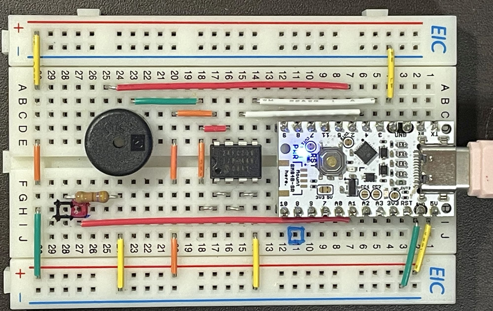
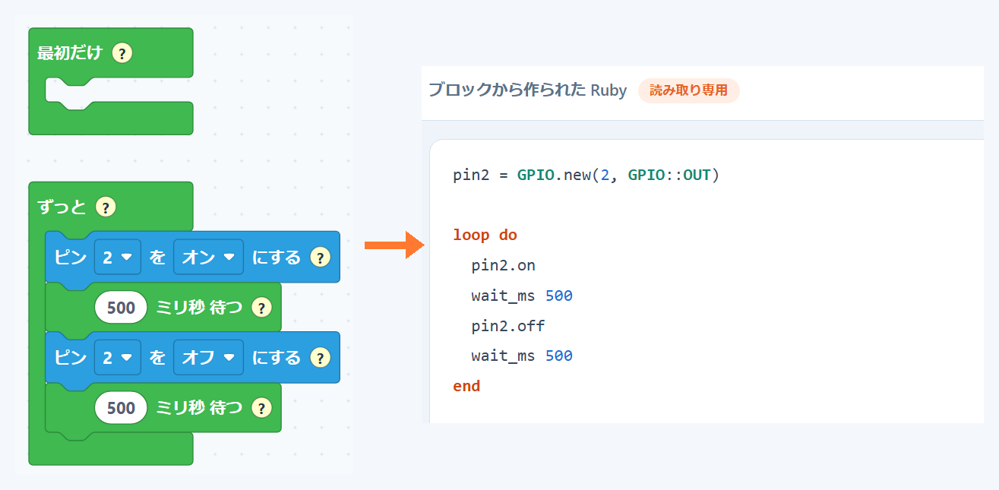
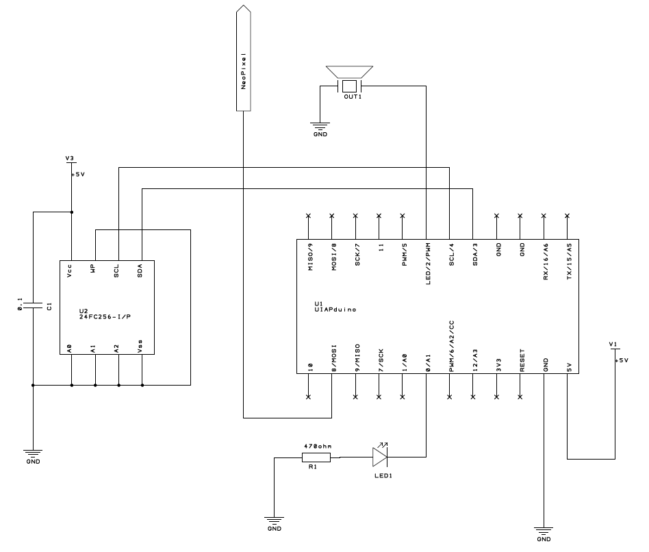
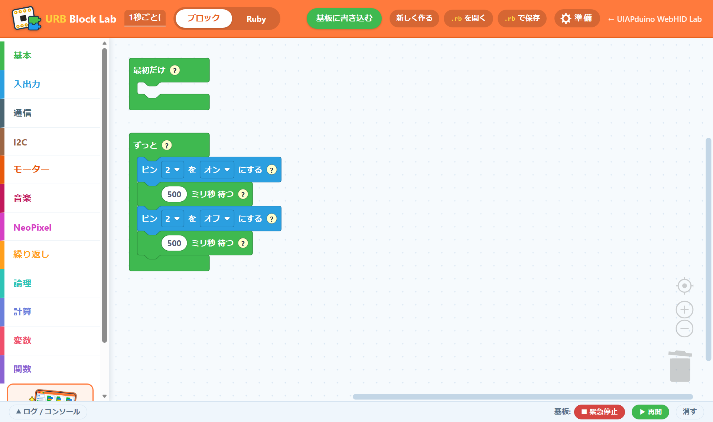
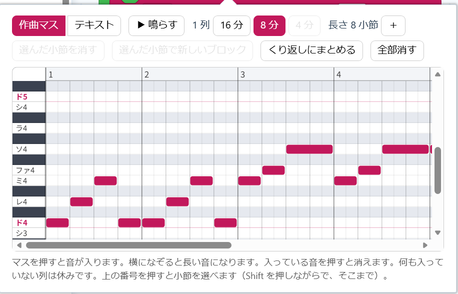

## 290 円のマイコンと 32KB の EEPROM 90 円で、Ruby とブロックのプログラミング環境ができる

_ブレッドボードに UIAPduino と 24FC256 を載せたところ_

CoderDojo 和歌山有田で、子どもたちにプログラミングを教えています。

写真に載っている部品のうち、プログラムを動かすのに必要なのは 2 個だけです。

- **UIAPduino**（CH32V003 のマイコン基板）… 290 円
- **24FC256**（32KB の EEPROM）… 90 円

この 2 個と、ブラウザ（Chrome か Edge）があれば、ブロックでも Ruby でもプログラムが作れます。PC にインストールするものはありません。

Scratch は、子どもたちにとって一番なじみのあるブロックです。ただ、Scratch のプログラムは PC の中で動くので、マイコンをつないでも、PC から外せば止まってしまいます。もの作りに使うマイコンは、単独で動く必要があります。

そこで作ったのが **URB Block** です。

## 作ったプログラムは EEPROM に入り、PC を外しても動き続ける

[URB Block Lab](https://tarosay.github.io/uiap-hid-web/uiapruby-block.html) でブロックを組んで「基板に書き込む」を押すと、プログラムは 24FC256 に入ります。

書き込んだら USB を抜いてかまいません。電源さえあれば、そのまま動き続けます。だからボタンの名前も「動かす」ではなく「**基板に書き込む**」にしています。

ブロックは Ruby に変換され、ブラウザの中でコンパイルされて、その結果が EEPROM に入ります。UIAPduino の中の VM が、それを EEPROM から読みながら実行します。Flash 16KB のマイコンでなぜこれができるのかは、別の記事で書くつもりです。

## 作品にマイコンを付けたままにできる

私が見ている限り、micro:bit などは、次のものを作るときに、前の作品から外して再利用しています。マイコンが高価だからです。

290 円なら、作品ごとに 1 つ付けておけます。次のものを作りたくなっても、今までの作品はそのまま。しばらく触っていない作品でも、付けたままにしておけば、また動かして見せられます。

再利用しなくてもいい。380 円程度でできるなら、もの作りの意欲がそがれることはありません。これが、私が UIAPduino に感動したところです。

## ブロックで始めて、同じマイコンのまま Ruby に進める

_組んだブロックは、Ruby のタブでそのまま Ruby として見られます_

URB Block Lab では、組んだブロックが Ruby になって、Ruby のタブに出てきます。ブロックを動かすと、Ruby もその場で変わります。

Ruby のタブは読み取り専用ですが、「**UIAPruby で編集する ↗**」を押すと、Ruby で書く [URB EE Lab](https://tarosay.github.io/uiap-hid-web/uiapruby-ee.html) にそのまま渡せます。そこからは Ruby で書き続けられます。

部品は同じ UIAPduino と 24FC256 のままです。新しく買うものはありません（URB EE Lab 用のファームウェアに書き込み直します）。

## micro:bit で教えてきた CoderDojo で、初めて URB Block を使った

CoderDojo 和歌山有田では、これまで micro:bit で教えてきました。micro:bit は MakeCode でブロックプログラミングをします。URB Block も MakeCode と同じブロックシステムで作っているので、micro:bit で慣れた子がそのまま移れます。

290 円のマイコンを、なんとか micro:bit のように使わせたい。それが URB Block を作った理由で、その答えが「**+90 円**」の EEPROM でした。

9 月 20 日の道場で、初めて URB Block を使いました。子どもたちは 8×8 の NeoPixel でコマ絵を作っていました。その様子を見て、こんなところを直しました。

- 色の見本が小さく、ブロック本体の「いろ」を押しに行っていた → マスの右に大きな色の見本を並べた
- 最初に白で塗りつぶす子が多かった → 真っ白から描き始められるようにした
- 「黒が黒くない」と言われた（LED では黒は消灯）→ 黒を「けす」という見た目にした
- 右にずらした絵を 1 枚ずつ描いていた → 絵を動かすボタン（ずらす・回す・裏返す）を足した

URB Block は、ブロックの画面から、ブラウザのコンパイラ、基板の中で動く VM、EEPROM の基板まで、全部私が作っています。だから、子どもがどこでつまずいても、直せます。

## 準備するもの ― ハードとソフト

### ハード

| 部品 | 値段 | |
|---|---|---|
| UIAPduino | 290 円 | マイコン基板 |
| 24FC256 | 90 円 | 32KB の EEPROM。プログラムと変数が入ります |
| ブレッドボード・ジャンパー線 | | |
| USB ケーブル（Type-C） | | 書き込みと電源 |

micro:bit は、LED の画面やボタン、センサーが最初から基板に載っていて、用意するだけでいろいろなプログラムが組めます。UIAPduino は、素の状態では LED を 1 つ光らせられるだけです。

その代わり、**作品に要る部品だけを足せばいい**。足していっても安く済みます。

| 足す部品 | 値段 | できること |
|---|---|---|
| 圧電スピーカー | 30 円 | 音・曲を鳴らす |
| 超音波センサー（HC-SR04） | 300 円 | 距離を測る |

_ブレッドボードの配置に合わせた回路図_

24FC256 のつなぎ方は次のとおりです。

- A0・A1・A2・Vss・WP → GND
- Vcc → 5V
- SDA → UIAPduino の 3 番
- SCL → UIAPduino の 4 番

パスコン C1（0.1µF）は、ブレッドボードでは省いています。

24FC256 の代わりに CAT24M01WI（128KB）でも動きます。どちらの石かは、URB Block のファームウェアが見分けます。ブレッドボードではなく、はんだ付けで UIAPduino に重ねる基板も作っています（[URB Block v1.3 の組み立て方](https://zenn.dev/tarosay/articles/urb-block-v1-3-assembly)）。

### ソフト

- **ブラウザ：Chrome か Edge**（WebHID を使います）。PC にインストールするものはありません
- **ファームウェア：基板 1 台につき一度だけ**、URB Block Lab の「⚙ 準備」から書き込みます
  1. 基板のボタンを押したまま、USB をつなぐ
  2. すぐにボタンを離す
  3. 「ファームウェアを書き込む」を押して、出てきた一覧から基板を選ぶ

作品を変えるたびに書き込む必要はありません。

## URB Block Lab を開いて、まず基板の LED を点滅させる

_ギャラリーの「1秒ごとに光る」_

最初は、部品を何も足さなくて大丈夫です。UIAPduino に載っている LED を点滅させます。

1. [「1秒ごとに光る」を URB Block Lab で開く](https://tarosay.github.io/uiap-hid-web/uiapruby-block.html?rb=sample-blink)
2. 「基板に書き込む」を押す

上の回路図のとおりに組んでいると、基板の LED と同じ 2 番にスピーカーがつながっているので、LED の点滅に合わせてスピーカーがチッチッと鳴ります。私はこの音が気に入っています。

ほかの作品は [URB ギャラリー](https://tarosay.github.io/urb-gallery/) に並んでいます。

## 30 円の圧電スピーカーを足せば、曲も鳴らせる

_曲の欄。何も置いていない列が、そのまま休符になります_

引き出し「音楽」のブロックで、曲を鳴らせます。曲の欄はピアノロールで、横が時間、縦が音の高さです。**何も置いていない列が、そのまま休符**になります。「▶ 鳴らす」を押すと、基板に書き込む前に PC のスピーカーで確かめられます。最初から「フレール・ジャック」が入っています。

300 円の超音波センサーも足せば、テルミンもどきも作れます。距離を読み込んで、「もし」で距離を区切り、区切りごとにドレミの音を鳴らし分けます。手を近づけたり離したりすると、音が変わります。

今月の CoderDojo 和歌山有田では、音楽のブロックを使って、クリスマスツリーを作ります。

- URB Block Lab：https://tarosay.github.io/uiap-hid-web/uiapruby-block.html
- URB ギャラリー：https://tarosay.github.io/urb-gallery/
- URB EE Lab（Ruby で書く）：https://tarosay.github.io/uiap-hid-web/uiapruby-ee.html
