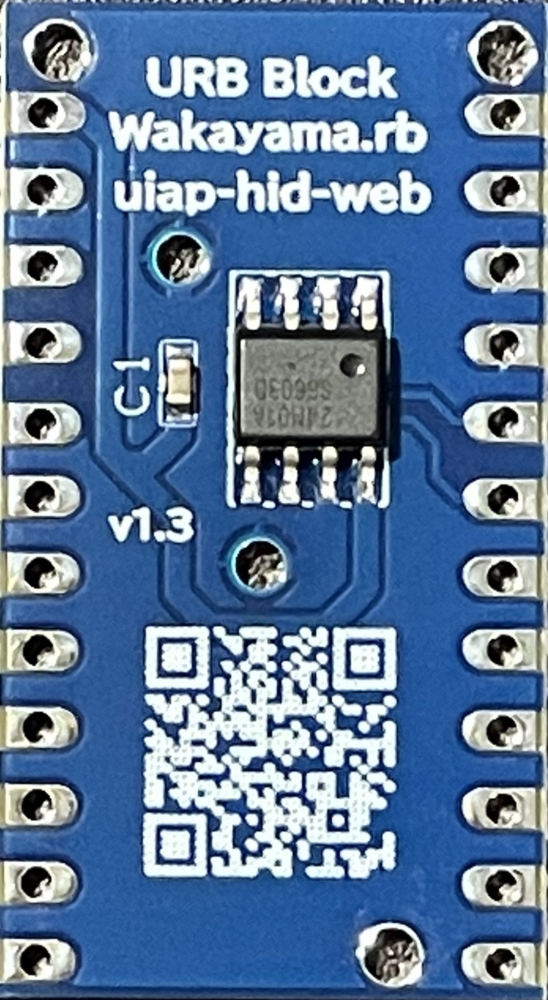
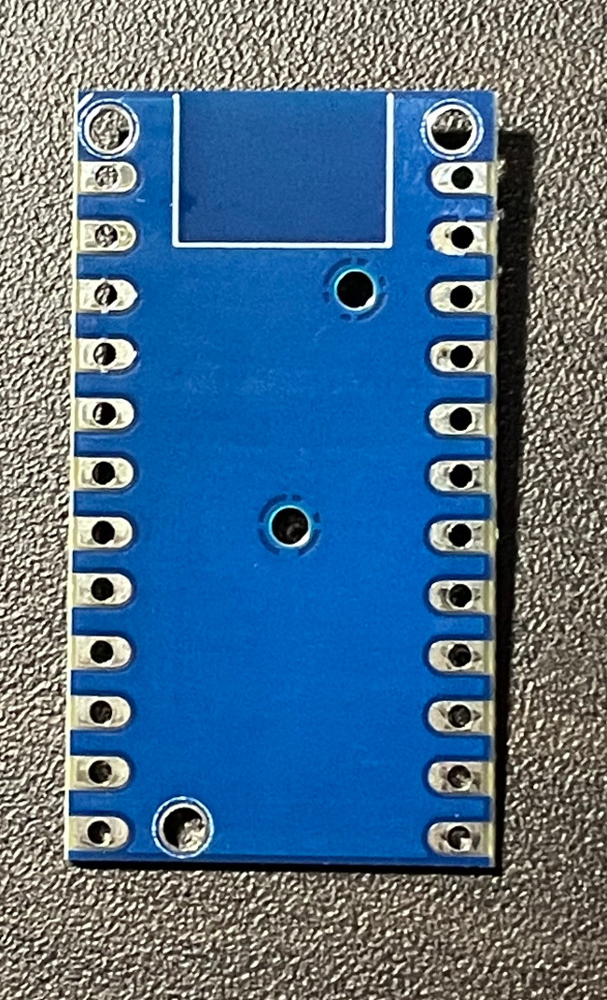
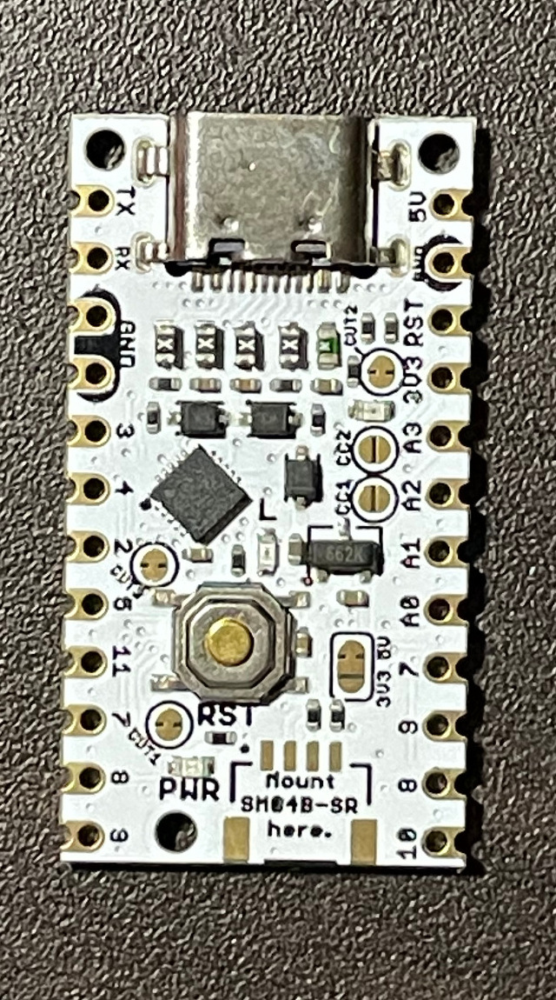
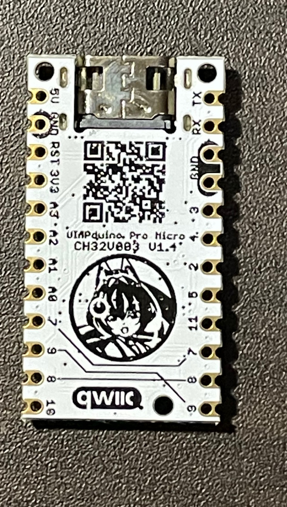

この記事では、**URB Block v1.3** をUIAPduinoに取り付ける方法を、写真を使って説明します。2枚の基板の重ね方と、はんだ付けの手順をまとめています。

## URB Block v1.3は何をする基板？

**UIAPduino** は、CH32V003を搭載したマイコン基板です。

**URB Block v1.3** は、UIAPduinoに **I2C接続のEEPROM** を追加するための基板です。

ブラウザ上で作成したRubyのプログラムは、UIAPduinoの小さな実行環境「TinyVM」向けのバイトコード（URB1形式）に変換され、EEPROMに書き込まれます。UIAPduinoは、そのバイトコードを読み出して実行します。EEPROMはプログラムだけでなく、変数などの保存にも使われます。

この仕組みは、ブロックからRubyを作る **URB Block Lab** だけのものではありません。Rubyコードを入力する **URB EE Lab** でも利用できます。書き込み後は、電源を供給すれば、PCに接続せずにプログラムを実行できます。

*URB Block v1.3。中央のICがEEPROMです。*

基板に印刷されたQRコードのリンク先は、各種ツールをまとめた [UIAPduino WebHID Lab](https://tarosay.github.io/uiap-hid-web/) です。

## 用意するもの

- URB Block v1.3 基板
- UIAPduino 基板
- 両側の端子に通すヘッダピン
- はんだごて、はんだ

この記事では、**URB Block v1.3の基板厚は1.0mm** です。後半のはんだ付け説明に使用する参考写真は、**基板厚1.6mmのURB Block基板** を使って撮影したものです。

### 2枚の基板の表裏

*URB Block v1.3の裏面。*

*UIAPduinoの部品面。*

*UIAPduinoの裏面。*

## 1. 向きを確認し、ヘッダピンで2枚を重ねる

UIAPduinoの **USB Type-Cコネクタが上** に来る向きで置きます。URB Block v1.3は、**部品がない青い裏面をUIAPduino側** に向けます。

2枚の基板の両側の端子穴をそろえ、ヘッダピンを通して重ねます。

*はんだ付け前の仮組み（真上から）。*

*斜めから見ると、2枚の基板とヘッダピンの位置関係が分かります。*

## 2. ヘッダピンをはんだ付けする

2枚の基板の位置がずれないようにして、ヘッダピンをはんだ付けします。**すべてのピンを丁寧にはんだ付け** してください。

*ヘッダピンのはんだ付け例（基板厚1.6mmの参考写真）。*

:::message alert
**ここで終わりではありません。** ヘッダピンをはんだ付けしただけでは、URB Block基板上のEEPROMがUIAPduinoにつながりません。次の **側面のはんだ付け** が必要です。
:::

## 3. 側面の端子をURB Blockの配線パターンにつなぐ

UIAPduinoの側面にある端子と、下側のURB Block基板の配線パターンを、はんだで電気的につなぎます。

接続する信号は、I2Cの2本と電源です。

| UIAPduinoの端子 | 役割 |
| --- | --- |
| 3番 | I2C SDA（データ） |
| 4番 | I2C SCL（クロック） |
| 5V | EEPROMの電源 |
| GND | GND（接地） |

### GND・3番・4番の側面

下の写真の **赤丸部分** のように、UIAPduinoの **GND・3番・4番** の側面から、URB Blockの配線パターンへはんだを流して接続します。

*左側の接続箇所（基板厚1.6mmの参考写真）。*

### 5V・GNDの側面

反対側も同様に、**5V・GND** とURB Blockの配線パターンをつなぎます。写真の赤丸部分が接続箇所です。

*電源側の接続箇所（基板厚1.6mmの参考写真）。*

重要なのは、**3番（SDA）、4番（SCL）、5V、GNDの4種類の信号** が、UIAPduinoからURB Blockへつながることです。参考資料ではGNDの接続箇所が両側に写っています。

はんだ付け作業はUSBケーブルを外した状態で行い、隣り合う端子を意図せずはんだでつないでしまわないようにしてください。

## 4. はんだ付けした箇所を確認する

組み立てが終わったら、次の点を目で確かめます。

- ヘッダピンの各端子がはんだ付けされている
- 3番・4番・5V・GNDの側面がURB Blockの配線パターンにつながっている
- 隣の端子同士にはんだの短絡がない

必要に応じて、電源をつなぐ前にテスターでも導通・短絡を確認してください。

## ピン配置と開発環境

*UIAPduinoピン配置図：Yuuki U.、CC BY 4.0（元の説明資料に掲載）。*

プログラムの作成・書き込みについては、[UIAPduino WebHID Lab](https://tarosay.github.io/uiap-hid-web/) を参照してください。URB Block LabやURB EE Labへの入口も、こちらにあります。

この記事は、**URB Block v1.3とUIAPduinoを接続するための組み立て手順** を説明したものです。これで、URB Block v1.3を使い始める準備が整います。
