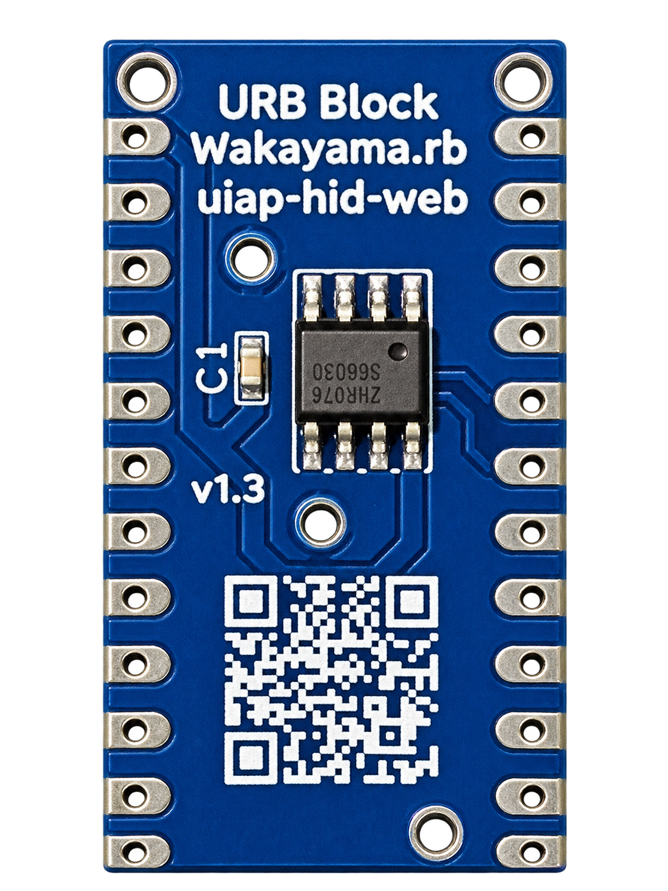
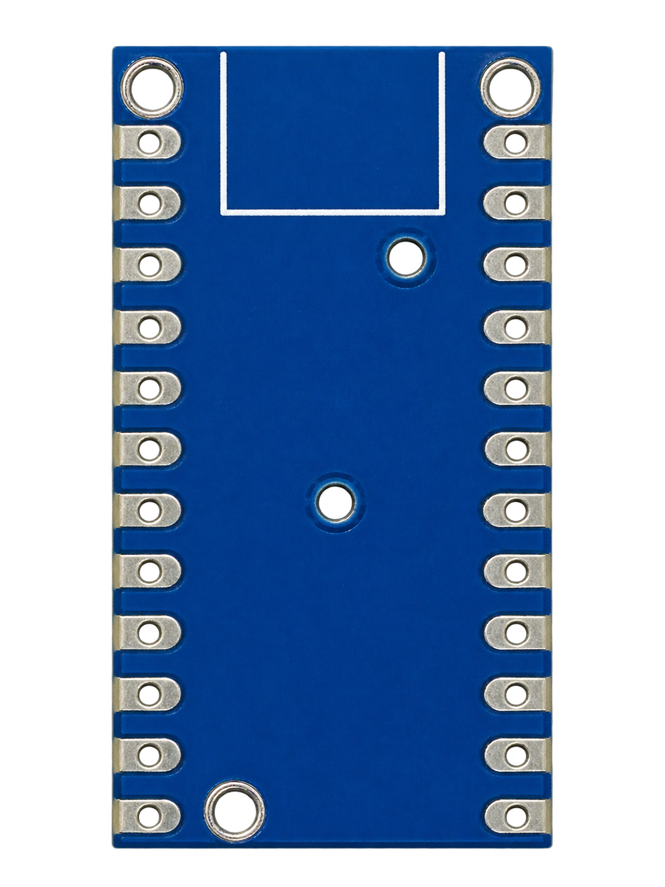
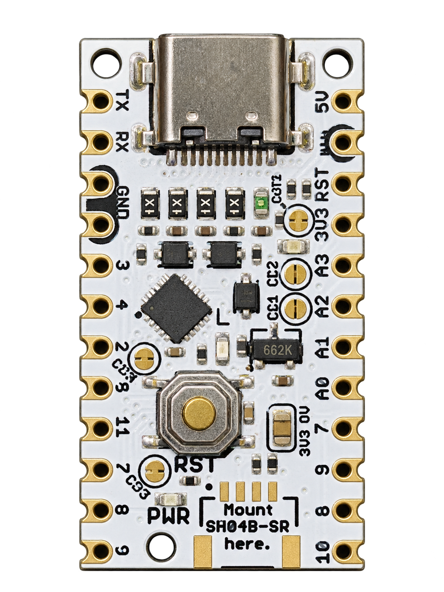
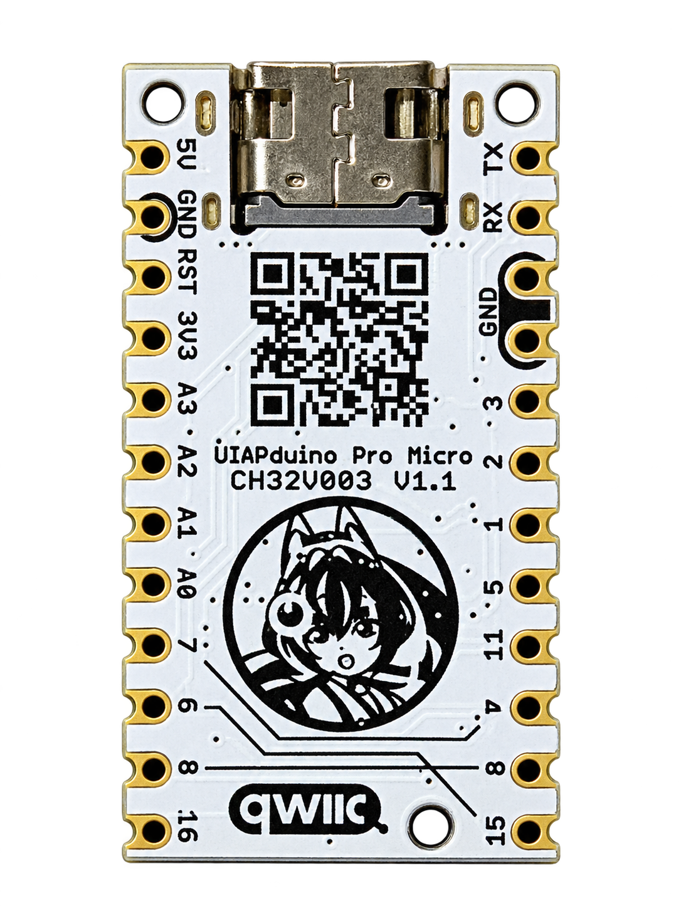
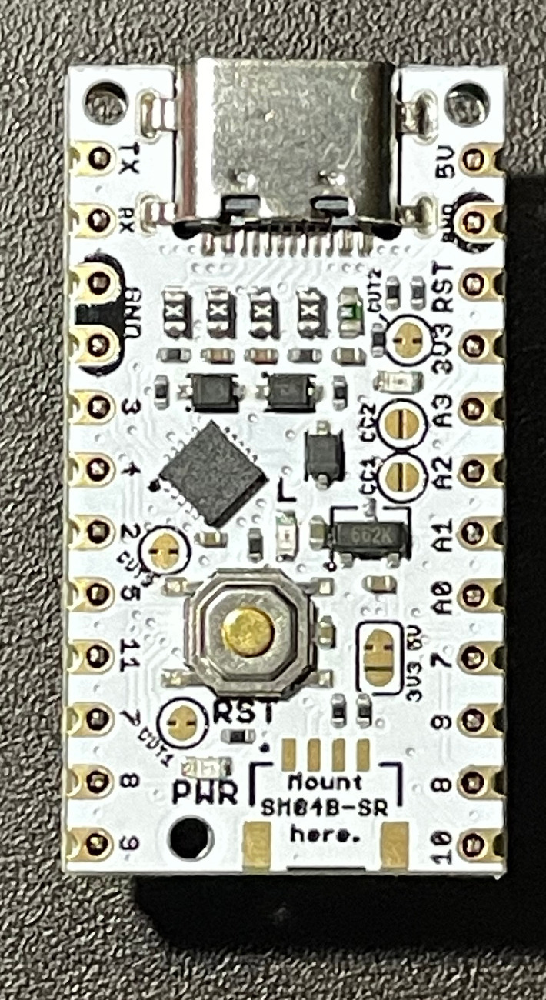
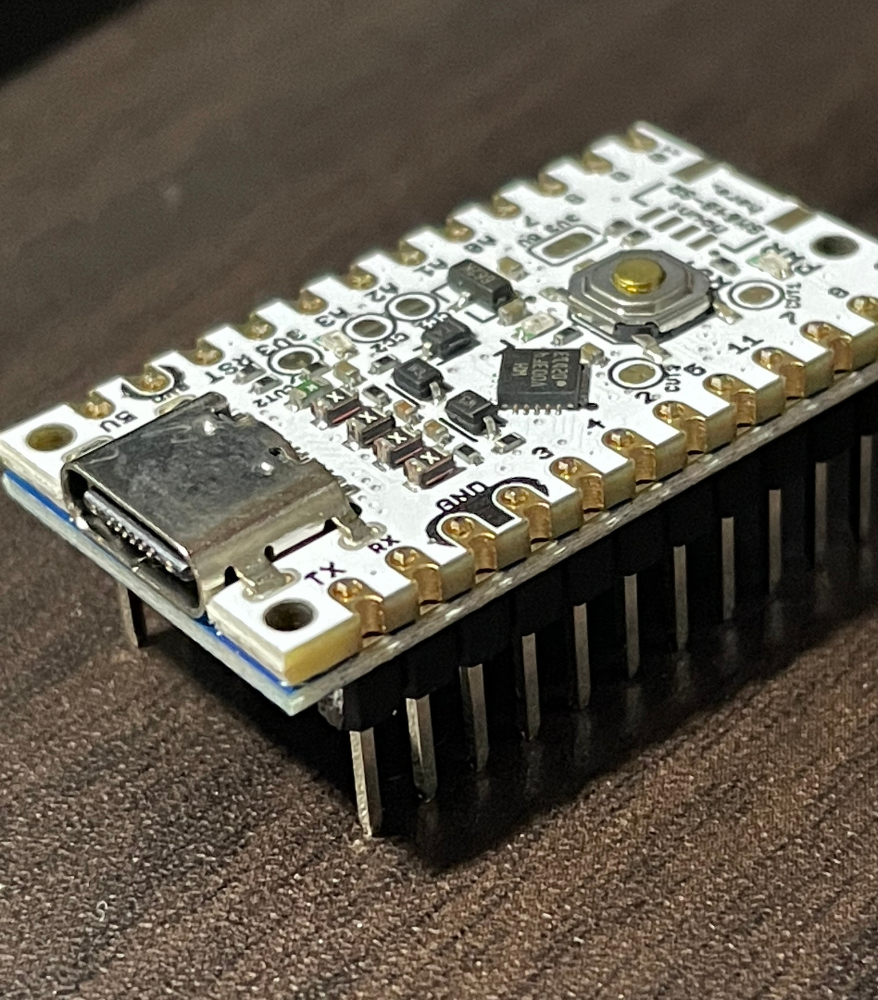
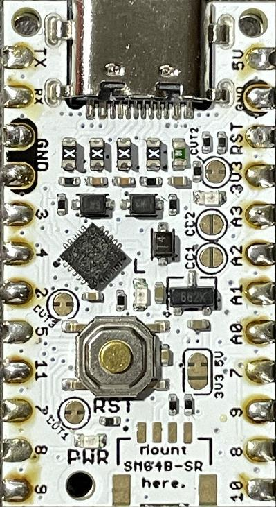
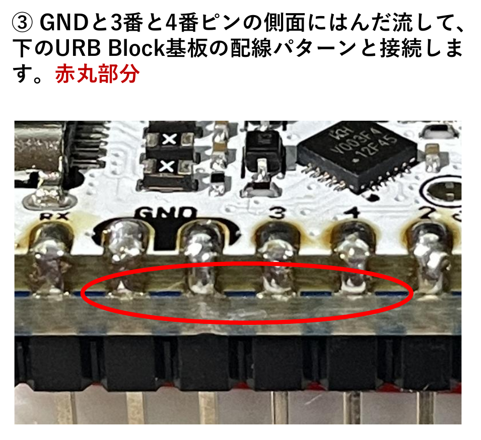
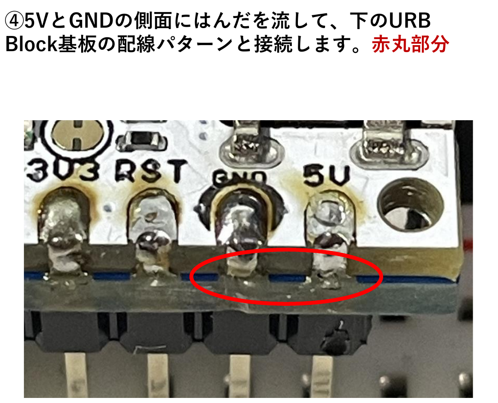
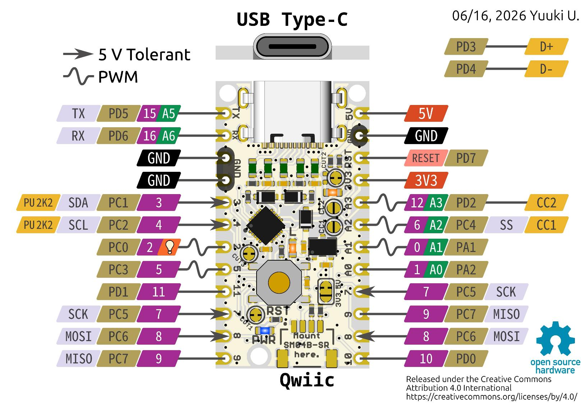

URB Block v1.3を受け取った方が、UIAPduinoと接続して使えるように、基板の重ね方とはんだ付け方法を写真で説明します。

先日、東京で多くの方に基板をお渡ししましたが、その場では組み立て方法まで説明できませんでした。この記事は、そのとき受け取った方にも、これから基板を手にする方にも使っていただくためのものです。

## URB Block v1.3は何をする基板？

**UIAPduino** は、CH32V003を搭載したマイコン基板です。

**URB Block v1.3** は、UIAPduinoに **I2C接続のEEPROM** を追加する基板です。RubyのプログラムをUIAPduino上の小さな実行環境 **TinyVM** で実行するため、Rubyから変換したバイトコード（URB1形式）をEEPROMに保存します。また、EEPROMは変数などの保存にも利用します。

プログラムの作成方法は、ブロックを使う **URB Block Lab** に限定されません。Rubyコードを直接入力する **URB EE Lab** でも利用できます。プログラムを書き込んだあとは、電源を供給することで、PCに接続せずに実行できます。

*URB Block v1.3。中央付近の8ピンICがEEPROMです。*

基板上のQRコードは、[UIAPduino WebHID Lab](https://tarosay.github.io/uiap-hid-web/) へのリンクです。プログラムの作成・書き込みに使うツールへは、こちらから進めます。

## 用意するもの

- URB Block v1.3基板
- UIAPduino基板
- 2列分のヘッダピン（基板両側の端子に取り付けるもの）
- はんだごて、はんだ

:::message
**写真の基板厚について**

今回のURB Block v1.3は **1.0mm厚** です。後半に掲載するはんだ付けの参考写真は、**1.6mm厚の基板** を使って撮影したものです。
:::

## 1. 基板の表と裏、重ねる向きを確認する

最初に、2枚の基板を確認します。

**URB Block v1.3** は、EEPROMが載っている面と、部品が載っていない青い面があります。

*URB Block v1.3の部品が載っていない面。*

**UIAPduino** の部品面には、USB Type-Cコネクタとリセットボタンがあります。

*UIAPduinoの部品面。*

*UIAPduinoの裏面。*

**重ねる向きが重要です。** UIAPduinoは部品面を上にし、URB Block v1.3は**部品のない青い面がUIAPduino側**を向くように重ねます。URB BlockのEEPROMが載った面は外側になります。

## 2. ヘッダピンを通して2枚を重ねる

両側の端子穴を合わせ、ヘッダピンを通して2枚を重ねます。はんだ付けの前に、向きと位置がずれていないことを確認してください。

*はんだ付け前の仮組み（真上から）。下側の基板は、上のUIAPduinoに隠れています。*

*斜めから見ると、重なった2枚の基板とヘッダピンの位置が分かります。*

## 3. ヘッダピンをはんだ付けする

2枚の基板をずらさないようにして、ヘッダピンの各端子をはんだ付けします。**両側のピンをすべてはんだ付け**してください。

*ヘッダピンのはんだ付け例。写真のURB Block基板は1.6mm厚です。*

:::message alert
**ヘッダピンのはんだ付けだけでは、EEPROMは接続されません。**

次に説明する、**UIAPduinoの側面端子とURB Blockの配線パターンをつなぐはんだ付け**が必要です。ここが大切な作業です。
:::

## 4. 側面をはんだ付けしてEEPROMを接続する

UIAPduinoの側面端子から、下側のURB Block v1.3の配線パターンへ、はんだを流して接続します。

接続に必要なのは **I2Cの信号2本と、電源の5V・GND** です。

| UIAPduinoの端子 | 用途 |
| --- | --- |
| **3番** | I2CのSDA（データ） |
| **4番** | I2CのSCL（クロック） |
| **5V** | 電源 |
| **GND** | グラウンド |

### 4-1. GND・3番・4番の側面

USBコネクタを上にしてUIAPduinoの部品面を見ると、**GND・3番・4番** は左側にあります。下の参考写真の**赤丸部分**のように、それぞれの端子の側面をURB Blockの配線パターンへはんだでつなぎます。

*GND・3番（SDA）・4番（SCL）の接続箇所。1.6mm厚基板による参考写真。*

### 4-2. 5V・GNDの側面

同じくUSBコネクタを上にして見ると、**5V・GND** は右側です。こちらも写真の**赤丸部分**をはんだで接続します。

*5V・GNDの接続箇所。1.6mm厚基板による参考写真。*

2枚の写真には、左右それぞれのGND端子が写っています。**必要な信号は3番（SDA）、4番（SCL）、5V、GNDの4種類**です。

:::message
側面のはんだ付けでは、**UIAPduinoの端子とURB Blockの配線パターンの両方にはんだがつながっていること**を確認してください。隣の端子とつながらないように注意します。
:::

## 5. はんだ付け後の確認

USBケーブルを外した状態で作業し、はんだ付けが終わったら、次の点を確認します。

- ヘッダピンの各端子がはんだ付けされていること
- **3番・4番・5V・GND** が、URB Blockの配線パターンに接続されていること
- 隣り合う端子間に、意図しないはんだのつながりがないこと

必要であれば、電源を入れる前にテスターで導通・短絡も確認してください。

## UIAPduinoのピン配置とプログラムの書き込み

各端子の位置は、次のピン配置図でも確認できます。

*UIAPduinoピン配置図。原図：Yuuki U.（CC BY 4.0）。*

プログラムの作成・書き込みには、[UIAPduino WebHID Lab](https://tarosay.github.io/uiap-hid-web/) をご覧ください。

このページで説明したのは、**Rubyを実行するためのEEPROM基板「URB Block v1.3」とUIAPduinoを接続する組み立て方法**です。EEPROMを使うためには、ヘッダピンだけでなく、側面の4種類の信号を確実に接続することがポイントです。
